# Voca

Voca 是一款专为英语口语进阶设计的开源 Android 客户端。项目起源于个人日常高频训练的真实诉求：排斥机械死记硬背单词与语法条文，希望通过每日三十分钟的真实语境交流逐步迈向地道流利表达，同时彻底解决通用语音交互频繁抢话打断构思、商业口语软件订阅高昂且模型规则封闭等核心痛点。

---

## 核心痛点与解决思路

### 1. 彻底解决思考停顿被抢话的交互困境
练习者在非母语表达过程中往往需要十秒甚至更长时间构思句式与挑选词汇。通用大模型的全双工实时语音与商业软件内置的静默感应（VAD）通常在一至三秒静音后即误判为发言结束并提前切入，造成严重的节奏打断与挫败感。Voca 彻底摒弃全自动断句，采用手动控制收音起止的回合制交互机制，赋予练习者充裕的表达与组织语言时间；同时支持中英混说，遇到表达卡壳或生词匮乏时可直接插入中文，由系统自动识别意图并给出地道的英文表达示范。

### 2. 破除商业口语应用的高昂溢价与黑盒锁定
市面主流商业口语应用普遍采用每年数百元的强制订阅制，其高昂定价源于平台对模型推理算力、商业运营以及音素级声学引擎的打包转售。实际上，个人每天三十分钟的对练调用各大供应商的公开接口，每月仅需极低的成本。Voca 坚持纯本地客户端架构，不设会员体系，采用自带密钥（Bring Your Own Key）模式，直连各大模型服务商，免去中间商溢价；同时系统提示词与交互参数完全对用户透明开放，支持自由定制场景与个性化设定。

### 3. 数据安全与隐私完全掌控
练习者的所有敏感接口凭证均依托 Android Keystore 进行硬件级加密保护；全部对话历史、录音流媒体与生词库均持久化存储于本地数据库，无需任何第三方云端服务器中转，彻底保障隐私资产安全。

---

## 产品体验与功能全景

### 1. 零步直达的主对话流
应用冷启动直接恢复历史对话，彻底舍弃多余的启动卡片与层级导航。界面视觉采用温暖沉静的羊皮纸基底与纸白卡片，消除高饱和色块对注意力的干扰。用户发言气泡右下角直接悬挂发音与语法双维综合分角标，以清晰色彩区分得分档位，点击即刻呼出深度评测抽屉；助手气泡下方常驻纯图标操作条，支持流式朗读、就地展开译文、收藏生词搭配与复制原文。

### 2. 极致手感的回合制输入条
对标成熟即时通讯工具的手势体验规范，底部输入区集成了高度定制的手势状态机：
- **按住即录**：触控录音按钮原地展开，微型波形电平柱实时跳动并计算录音时长；
- **左滑作废**：手指左滑带动按钮缩减并跟随手指位移，滑过阈值即刻触发作废动效；
- **上滑锁定**：向上滑动平滑进入免手持持续录音模式；
- **暂停与试听**：锁定状态下支持随时暂停收音，调出紧凑的振幅时间轴进行原声回放试听，确认无误后轻触发送。

### 3. 多维半屏评测抽屉
轻触对话气泡的得分角标即可平滑唤起半屏评测抽屉，提供完整的表达诊断闭环：
- **原声复听**：完整回放练习者刚才录下的真实音频切片；
- **音素级声学偏误定位**：基于国际音标精准标出读错的元音、次重音缺失或辅音偏差；
- **双档位母语者改写**：同时提供贴合原意的“地道改写”与丰富句式的“高级进阶”双版本，并附带通俗易懂的中文差异点拨；
- **语境生词一键归集**：从当前交流语境中自动提炼关键词汇与高价值词组，一键收录进个人生词库。

### 4. 语境生词库与认知间隔复习
坚决不做孤立词汇列表，生词库仅承载对话中真实产生的高频表达：
- **完整语境沉淀**：每张词卡均完整记录词形、国际音标、中文释义以及对话中的真实英文例句，例句中的目标搭配施加醒目高亮；
- **多语言神经语音朗读**：调用高质量神经语音合成引擎完成单词与完整例句的连续朗读，确保听觉输入的自然流畅；
- **认知周期归类**：结合间隔复现规律，自动按“今天”、“待复习”与“更早”动态归组，支持左滑手势删除与撤销保护。

### 5. 灵活的供应商定制与打卡热力图
- **完全解耦的三层配置**：实时对话、发音评测、文本分析三条管线各自独立配置，支持任意混搭不同厂商的高性价比模型与音色；
- **练习热力图**：设置页提供 26 周 × 7 天的练习热力矩阵，基于真实录音时长精准计算每日活跃度，清晰记录口语进阶的每一步蜕变。

---

## 二语习得与认知科学机制

- **可理解性输入理论（Comprehensible Input, i+1）**：日常口语交流绝大部分场景主要依赖基础的高频词汇。Voca 通过引导模型维持略高于当前水平的地道表达，激活练习者原本储存在阅读记忆里的被动词汇，使其在两至四周的对话输出中转化为主动表达。
- **语境习得与自然复现**：排斥枯燥孤立的词汇背诵。在真实交流中接触的新词搭配，通过系统在后续多轮对话语境中主动复现七至十二次，实现向长期记忆的自然转化。
- **即时纠偏与母语者改写（Recasting）**：不中断对话节奏，在每轮交流末尾以轻量反馈形式提供一至两处关键偏误的母语者改写与通俗中文解析，依靠高频输出建立语感，避免机械语法分析带来的认知负荷。

---

## 架构设计

产品架构紧密围绕“沉浸表达、认知科学闭环与自主掌控”三大核心价值展开，纵向划分为用户触达与交互层、认知科学与学习闭环层、核心业务能力中枢层以及开放生态与数据安全层，实现产品体验与二语习得理论的深度融合。

```mermaid
flowchart TD
    subgraph L1["1. 用户触达与交互层"]
        ChatScreen["沉浸对话台（极简纸面 / 流式气泡 / 综合分角标）"]
        InputControl["手势收音台（按住即录 / 思考停顿 / 左滑作废 / 上滑锁定 / 暂停试听）"]
        ReviewSheet["深度评测台（原声复听 / 国际音标纠偏 / 地道与进阶双档改写）"]
        VocabBook["语境生词台（真实对话例句 / 目标搭配高亮 / 神经语音朗读）"]
        Dashboard["配置与成长中心（三维服务自由装配 / 音色试听 / 26周练习热力图）"]
    end

    subgraph L2["2. 认知科学与学习闭环层"]
        Buffer["思维构思缓冲（消除自动抢话打断，保障10-60秒深度语言组织空间）"]
        CI["可理解性输入闭环（i+1 略高于现有水平的地道语境输入，激活阅读被动词汇）"]
        Recast["隐性重述纠偏闭环（每轮交流末尾提供母语者改写与通俗点拨，护航表达流）"]
        Spaced["间隔复现内化闭环（从对话提炼高价值搭配，后续多轮复现 7-12 次内化到长期记忆）"]
        DualMemory["双层记忆联动闭环（Session 即时轮次事实萃取 + Global 跨会话长期画像继承）"]
    end

    subgraph L3["3. 核心业务能力中枢层"]
        LiveHub["实时拟人对话引擎（母语者抑扬顿挫流式语音，自然情绪起伏）"]
        AcousticHub["精细声学诊断引擎（国际音标强制对齐、音素级偏误定位、语调韵律打分）"]
        TextHub["异步语义分析引擎（语法逻辑校验、多档位地道改写、语境生词高亮提取）"]
        MemoryHub["记忆账本调度中枢（MemoryLedger 增量合并、字数熔断控制、设置页透明可调）"]
        AssetHub["学习资产沉淀引擎（会话生命周期管理、每日练习时长精准统计、生词复现追踪）"]
    end

    subgraph L4["4. 开放生态与数据安全层"]
        LiveVendors["实时对话池（Google Gemini Live / OpenAI Realtime / 火山豆包 / 阿里千问）"]
        AssessVendors["专业评测池（微软 Azure Speech / 腾讯智聆 / 科大讯飞流式）"]
        TextVendors["智能文本池（DeepSeek / Claude / Kimi / GLM / OpenAI 兼容端点）"]
        PrivacyVault["本地安全闭环（自带密钥直连 / 硬件级密钥隔离 / 对话历史与录音全本地存储）"]
    end

    L1 --> L2
    L2 --> L3
    L3 --> L4
```



### 业务分层剖析

- **用户触达与交互层（Interaction & Experience）**：以极简主义设计化解口语训练的心理门槛。冷启动直达对话界面，羊皮纸底色营造沉浸交流场域；手势收音台赋予练习者对节奏的绝对掌控力，彻底消解发言中断焦虑；评测与生词以抽屉与卡片形态轻量唤起，不阻断主对话连续性。
- **认知科学与学习闭环层（Cognitive & Learning Loop）**：将二语习得理论全面产品化。通过回合制机制保留充分构思间隙以缓解认知负荷；以略高于现有水平（i+1）的可理解性输入激发被动词汇；依托隐性重述（Recasting）在不打断表达连贯性的前提下即时纠偏；基于间隔复现机制将高频搭配在多轮对话中高频复现，实现向长期记忆的稳步内化；依托双层记忆架构（Session 级短期即时事实追踪与 Global 级长期画像沉淀），使 AI 能够准确记住个人身份、真实生活经历以及反复出现薄弱点，驱动个性化的高价值语境输入。
- **核心业务能力中枢层（Core Capabilities）**：驱动练习闭环的高效运转。实时拟人对话中枢提供具备情绪张力与真实停顿感的高自然度声学互动；声学诊断中枢深入单词音标维度定位发音偏误；异步文本分析中枢在后台静默完成多档位母语者改写与高价值搭配提取；记忆调度中枢负责轮次事实的增量提炼与跨会话档案的平滑注入，并在设置页提供完全透明可改的文字视图；资产管理中枢如实量化开口时长，构筑可视化的口语成长路径。
- **开放生态与数据安全层（Open Ecosystem & Privacy）**：践行“自带密钥（BYOK）”与“纯本地化”的产品理念。彻底剥离商业口语软件的强制订阅与中间商溢价，支持自由选配主流模型服务商与优质音色；全量敏感凭据与历史学习资产完全沉淀于本机，无需任何第三方云端中转，守护个人隐私与数据安全。

---

## 技术栈与开发指南

- **平台与开发语言**：Android 原生开发，Kotlin 配合 Jetpack Compose 声明式 UI。
- **音频流处理**：AudioRecord 原生音频采集（48 kHz 采样封为 Ogg/Opus，下采样至 16 kHz 20ms 流式帧传输）。
- **状态驱动**：确定性单向数据流状态机管理，网络会话标识与主线程原子互斥隔离。
- **构建与测试**：执行 `tools/gate.sh` 编译并运行单元测试。

### 本地构建

需要 JDK 17 与 Android SDK（Platform 37）。首次构建要联网拉依赖：

```bash
cd android && ./gradlew :app:assembleDebug
```

日常验收走 `tools/gate.sh`，它调用 `--offline`，靠本机已有的 Gradle 缓存编译 debug 变体并跑单元测试，带参数就只跑指定任务，例如 `tools/gate.sh :app:testDebugUnitTest`。装到手机上走 `.agents/skills/android-device-testing/scripts/android-drive.sh install`，它自己处理厂商的安装拦截框。

供应商凭据在设置页填写，经 Android Keystore 加密后只留在本机。仓库根目录的 `.env` 只用来覆盖开发时的默认模型名与音色，不进版本库，也不参与 release 包。

---

## 许可

Apache License 2.0，全文见 [LICENSE](LICENSE)。
