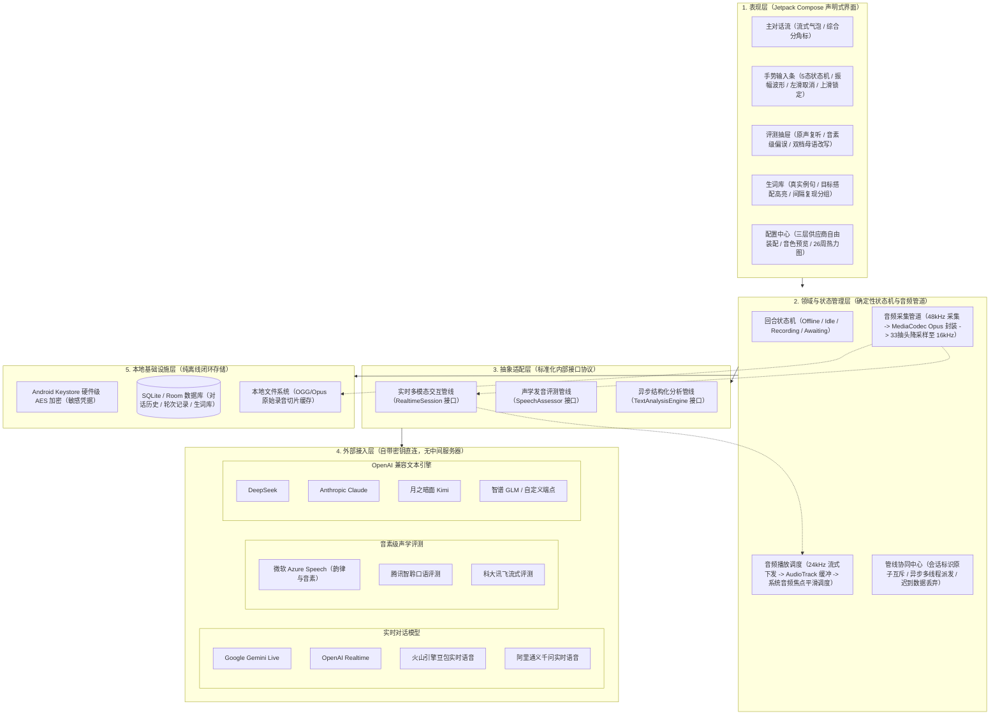

# Parley

Parley 是一款专为英语口语进阶设计的开源 Android 客户端。项目起源于个人日常高频训练的真实诉求：排斥机械死记硬背单词与语法条文，希望通过每日三十分钟的真实语境交流逐步迈向地道流利表达，同时彻底解决通用语音交互频繁抢话打断构思、商业口语软件订阅高昂且模型规则封闭等核心痛点。

---

## 核心痛点与解决思路

### 1. 彻底解决思考停顿被抢话的交互困境
练习者在非母语表达过程中往往需要十秒甚至更长时间构思句式与挑选词汇。通用大模型的全双工实时语音与商业软件内置的静默感应（VAD）通常在一至三秒静音后即误判为发言结束并提前切入，造成严重的节奏打断与挫败感。Parley 彻底摒弃全自动断句，采用手动控制收音起止的回合制交互机制，赋予练习者充裕的表达与组织语言时间；同时支持中英混说，遇到表达卡壳或生词匮乏时可直接插入中文，由系统自动识别意图并给出地道的英文表达示范。

### 2. 破除商业口语应用的高昂溢价与黑盒锁定
市面主流商业口语应用普遍采用每年数百元的强制订阅制，其高昂定价源于平台对模型推理算力、商业运营以及音素级声学引擎的打包转售。实际上，个人每天三十分钟的对练调用各大供应商的公开接口，每月仅需极低的成本。Parley 坚持纯本地客户端架构，不设会员体系，采用自带密钥（Bring Your Own Key）模式，直连各大模型服务商，免去中间商溢价；同时系统提示词与交互参数完全对用户透明开放，支持自由定制场景与个性化设定。

### 3. 数据安全与隐私完全掌控
练习者的所有敏感接口凭证均依托 Android Keystore 进行硬件级加密保护；全部对话历史、录音流媒体与生词库均持久化存储于本地数据库，无需任何第三方云端服务器中转，彻底保障隐私资产安全。

---

## 产品体验与功能全景

### 1. 零步直达的主对话流
应用冷启动直接恢复历史对话，彻底舍弃多余的启动卡片与层级导航。界面视觉采用温暖沉静的羊皮纸基底与纸白卡片，消除高饱和色块对注意力的干扰。用户发言气泡右下角直接悬挂发音与语法双维综合分角标，以清晰色彩区分得分档位，点击即刻呼出深度评测抽屉；助手气泡下方常驻纯图标操作条，支持流式朗读、就地展开译文、收藏生词搭配与复制原文。

### 2. 极致手感的回合制输入条
对标成熟即时通讯工具的手势体验规范，底部输入区集成了高度定制的手势状态机：
- **按住即录**：触控录音按钮原地展开，微型波形电平柱实时跳动并计算录音时长；
- **左滑作废**：手指左滑带动按钮缩减并跟随手指位移，滑过阈值即刻触发作废动效；
- **上滑锁定**：向上滑动平滑进入免手持持续录音模式；
- **暂停与试听**：锁定状态下支持随时暂停收音，调出紧凑的振幅时间轴进行原声回放试听，确认无误后轻触发送。

### 3. 多维半屏评测抽屉
轻触对话气泡的得分角标即可平滑唤起半屏评测抽屉，提供完整的表达诊断闭环：
- **原声复听**：完整回放练习者刚才录下的真实音频切片；
- **音素级声学偏误定位**：基于国际音标精准标出读错的元音、次重音缺失或辅音偏差；
- **双档位母语者改写**：同时提供贴合原意的“地道改写”与丰富句式的“高级进阶”双版本，并附带通俗易懂的中文差异点拨；
- **语境生词一键归集**：从当前交流语境中自动提炼关键词汇与高价值词组，一键收录进个人生词库。

### 4. 语境生词库与认知间隔复习
坚决不做孤立词汇列表，生词库仅承载对话中真实产生的高频表达：
- **完整语境沉淀**：每张词卡均完整记录词形、国际音标、中文释义以及对话中的真实英文例句，例句中的目标搭配施加醒目高亮；
- **多语言神经语音朗读**：调用高质量神经语音合成引擎完成单词与完整例句的连续朗读，确保听觉输入的自然流畅；
- **认知周期归类**：结合间隔复现规律，自动按“今天”、“待复习”与“更早”动态归组，支持左滑手势删除与撤销保护。

### 5. 灵活的供应商定制与打卡热力图
- **完全解耦的三层配置**：实时对话、发音评测、文本分析三条管线各自独立配置，支持任意混搭不同厂商的高性价比模型与音色；
- **练习热力图**：设置页提供 26 周 × 7 天的练习热力矩阵，基于真实录音时长精准计算每日活跃度，清晰记录口语进阶的每一步蜕变。

---

## 二语习得与认知科学机制

- **可理解性输入理论（Comprehensible Input, i+1）**：日常口语交流绝大部分场景主要依赖基础的高频词汇。Parley 通过引导模型维持略高于当前水平的地道表达，激活练习者原本储存在阅读记忆里的被动词汇，使其在两至四周的对话输出中转化为主动表达。
- **语境习得与自然复现**：排斥枯燥孤立的词汇背诵。在真实交流中接触的新词搭配，通过系统在后续多轮对话语境中主动复现七至十二次，实现向长期记忆的自然转化。
- **即时纠偏与母语者改写（Recasting）**：不中断对话节奏，在每轮交流末尾以轻量反馈形式提供一至两处关键偏误的母语者改写与通俗中文解析，依靠高频输出建立语感，避免机械语法分析带来的认知负荷。

---

## 架构设计

系统遵循整洁架构（Clean Architecture）与依赖倒置原则，全面划分为表现层、领域与状态管理层、服务抽象适配层、外部接入层以及本地基础设施层，实现实时交互、发音评测与文本分析三条业务管线的彻底解耦。

### 分层职责剖析

- **表现层（Presentation Layer）**：依托 Jetpack Compose 打造，将输入手势、波形动效与对话流彻底解耦。底部输入条独立管理触控生命周期与手势判定，长按展开录音并实时驱动分贝振幅波形，左滑联动位移阈值作废，上滑无缝锁定免手持；气泡与半屏抽屉仅对上层事件流做无状态投影。
- **领域与状态管理层（Domain & State Layer）**：收敛于单状态机的确定性调度。上行音频通过 AudioRecord 录入 48 kHz 原始流，经 MediaCodec 实时编码为标准 Opus 封装入 OGG 文件持久化留存，同时采用 33 抽头窗函数 sinc 滤波器降采样至 16 kHz 20 毫秒数据包直推实时管线；下行 24 kHz 音频流经由独立线程与 AudioTrack 播放，并接入系统音频焦点避让外部事件。
- **服务抽象适配层（Service Abstraction Layer）**：严格贯彻依赖倒置原则。客户端内部确立统一的事件契约（用户语音活动、识别文本、模型响应、音频块、回合终结、异常状态），实时对话、发音评测与异步分析三条链路互不侵入、各自独立演进，业务层不编写任何特定服务商的分支逻辑。
- **外部接入层（External Provider Layer）**：遵循“自带密钥（BYOK）”理念，客户端直连云端各大通用多模态模型与专业声学评测接口，彻底消除第三方业务服务器中转与数据转售链条。
- **本地基础设施层（Infrastructure Layer）**：敏感密钥全部由 Android Keystore 实施硬件级隔离保护，聊天历史、轮次数据与语境生词持久化于本地 SQLite/Room 数据库，彻底保障离线闭环与个人隐私资产安全。

---

## 技术栈与开发指南

- **平台与开发语言**：Android 原生开发，Kotlin 配合 Jetpack Compose 声明式 UI。
- **音频流处理**：AudioRecord 原生音频采集（48 kHz 采样封为 Ogg/Opus，下采样至 16 kHz 20ms 流式帧传输）。
- **状态驱动**：确定性单向数据流状态机管理，网络会话标识与主线程原子互斥隔离。
- **构建与测试**：执行 `tools/gate.sh` 编译并运行单元测试。
