# Voca

Voca 是一款专为英语口语进阶设计的开源 Android 客户端。项目起源于个人日常高频训练的真实诉求：排斥机械死记硬背单词与语法条文，希望通过每日三十分钟的真实语境交流逐步迈向地道流利表达，同时彻底解决通用语音交互频繁抢话打断构思、商业口语软件订阅高昂且模型规则封闭等核心痛点。

---

## 核心痛点与解决思路

### 1. 彻底解决思考停顿被抢话的交互困境
练习者在非母语表达过程中往往需要十秒甚至更长时间构思句式与挑选词汇。通用大模型的全双工实时语音与商业软件内置的静默感应（VAD）通常在一至三秒静音后即误判为发言结束并提前切入，造成严重的节奏打断与挫败感。Voca 彻底摒弃全自动断句，采用手动控制收音起止的回合制交互机制，赋予练习者充裕的表达与组织语言时间；同时支持中英混说，遇到表达卡壳或生词匮乏时可直接插入中文，由系统自动识别意图并给出地道的英文表达示范。

### 2. 破除商业口语应用的高昂溢价与黑盒锁定
市面主流商业口语应用普遍采用每年数百元的强制订阅制，其高昂定价源于平台对模型推理算力、商业运营以及音素级声学引擎的打包转售。实际上，个人每天三十分钟的对练调用各大供应商的公开接口，每月仅需极低的成本。Voca 坚持纯本地客户端架构，不设会员体系，采用自带密钥（Bring Your Own Key）模式，直连各大模型服务商，免去中间商溢价；同时系统提示词与交互参数完全对用户透明开放，支持自由定制场景与个性化设定。

### 3. 数据安全与隐私完全掌控
练习者的所有敏感接口凭证均依托 Android Keystore 进行硬件级加密保护；全部对话历史、录音流媒体与生词库均持久化存储于本地数据库，无需任何第三方云端服务器中转，彻底保障隐私资产安全。

---

## 产品体验与功能全景

### 1. 零步直达的主对话流
应用冷启动直接恢复历史对话，彻底舍弃多余的启动卡片与层级导航。界面视觉采用温暖沉静的羊皮纸基底与纸白卡片，消除高饱和色块对注意力的干扰。用户发言气泡右下角直接悬挂发音与语法双维综合分角标，以清晰色彩区分得分档位，点击即刻呼出深度评测抽屉；助手气泡下方常驻纯图标操作条，支持流式朗读、就地展开译文、收藏生词搭配与复制原文。

### 2. 极致手感的回合制输入条
对标成熟即时通讯工具的手势体验规范，底部输入区集成了高度定制的手势状态机：
- **按住即录**：触控录音按钮原地展开，微型波形电平柱实时跳动并计算录音时长；
- **左滑作废**：手指左滑带动按钮缩减并跟随手指位移，滑过阈值即刻触发作废动效；
- **上滑锁定**：向上滑动平滑进入免手持持续录音模式；
- **暂停与试听**：锁定状态下支持随时暂停收音，调出紧凑的振幅时间轴进行原声回放试听，确认无误后轻触发送。

### 3. 多维半屏评测抽屉
轻触对话气泡的得分角标即可平滑唤起半屏评测抽屉，提供完整的表达诊断闭环：
- **原声复听**：完整回放练习者刚才录下的真实音频切片；
- **音素级声学偏误定位**：基于国际音标精准标出读错的元音、次重音缺失或辅音偏差；
- **双档位母语者改写**：同时提供贴合原意的“地道改写”与丰富句式的“高级进阶”双版本，并附带通俗易懂的中文差异点拨；
- **语境生词一键归集**：从当前交流语境中自动提炼关键词汇与高价值词组，一键收录进个人生词库。

### 4. 语境生词库与认知间隔复习
坚决不做孤立词汇列表，生词库仅承载对话中真实产生的高频表达：
- **完整语境沉淀**：每张词卡均完整记录词形、国际音标、中文释义以及对话中的真实英文例句，例句中的目标搭配施加醒目高亮；
- **多语言神经语音朗读**：调用高质量神经语音合成引擎完成单词与完整例句的连续朗读，确保听觉输入的自然流畅；
- **认知周期归类**：结合间隔复现规律，自动按“今天”、“待复习”与“更早”动态归组，支持左滑手势删除与撤销保护。

### 5. 灵活的供应商定制与打卡热力图
- **完全解耦的三层配置**：实时对话、发音评测、文本分析三条管线各自独立配置，支持任意混搭不同厂商的高性价比模型与音色；
- **练习热力图**：设置页提供 26 周 × 7 天的练习热力矩阵，基于真实录音时长精准计算每日活跃度，清晰记录口语进阶的每一步蜕变。

---

## 二语习得与认知科学机制

- **可理解性输入理论（Comprehensible Input, i+1）**：日常口语交流绝大部分场景主要依赖基础的高频词汇。Voca 通过引导模型维持略高于当前水平的地道表达，激活练习者原本储存在阅读记忆里的被动词汇，使其在两至四周的对话输出中转化为主动表达。
- **语境习得与自然复现**：排斥枯燥孤立的词汇背诵。在真实交流中接触的新词搭配，通过系统在后续多轮对话语境中主动复现七至十二次，实现向长期记忆的自然转化。
- **即时纠偏与母语者改写（Recasting）**：不中断对话节奏，在每轮交流末尾以轻量反馈形式提供一至两处关键偏误的母语者改写与通俗中文解析，依靠高频输出建立语感，避免机械语法分析带来的认知负荷。

---

## 架构设计

产品架构紧密围绕“沉浸表达、认知科学闭环与自主掌控”三大核心价值展开，纵向划分为用户触达与交互层、认知科学与学习闭环层、核心业务能力中枢层以及开放生态与数据安全层，实现产品体验与二语习得理论的深度融合。

```mermaid
flowchart TD
    subgraph L1["1. 用户触达与交互层"]
        ChatScreen["沉浸对话台（极简纸面 / 流式气泡 / 综合分角标）"]
        InputControl["手势收音台（按住即录 / 思考停顿 / 左滑作废 / 上滑锁定 / 暂停试听）"]
        ReviewSheet["深度评测台（原声复听 / 国际音标纠偏 / 地道与进阶双档改写）"]
        VocabBook["语境生词台（真实对话例句 / 目标搭配高亮 / 神经语音朗读）"]
        Dashboard["配置与成长中心（三维服务自由装配 / 音色试听 / 26周练习热力图）"]
    end

    subgraph L2["2. 认知科学与学习闭环层"]
        Buffer["思维构思缓冲（消除自动抢话打断，保障10-60秒深度语言组织空间）"]
        CI["可理解性输入闭环（i+1 略高于现有水平的地道语境输入，激活阅读被动词汇）"]
        Recast["隐性重述纠偏闭环（每轮交流末尾提供母语者改写与通俗点拨，护航表达流）"]
        Spaced["间隔复现内化闭环（从对话提炼高价值搭配，后续多轮复现 7-12 次内化到长期记忆）"]
        DualMemory["双层记忆联动闭环（Session 即时轮次事实萃取 + Global 跨会话长期画像继承）"]
    end

    subgraph L3["3. 核心业务能力中枢层"]
        LiveHub["实时拟人对话引擎（母语者抑扬顿挫流式语音，自然情绪起伏）"]
        AcousticHub["精细声学诊断引擎（国际音标强制对齐、音素级偏误定位、语调韵律打分）"]
        TextHub["异步语义分析引擎（语法逻辑校验、多档位地道改写、语境生词高亮提取）"]
        MemoryHub["记忆账本调度中枢（MemoryLedger 增量合并、字数熔断控制、设置页透明可调）"]
        AssetHub["学习资产沉淀引擎（会话生命周期管理、每日练习时长精准统计、生词复现追踪）"]
    end

    subgraph L4["4. 开放生态与数据安全层"]
        LiveVendors["实时对话池（Google Gemini Live / OpenAI Realtime / 火山豆包 / 阿里千问）"]
        AssessVendors["专业评测池（微软 Azure Speech / 腾讯智聆 / 科大讯飞流式）"]
        TextVendors["智能文本池（DeepSeek / Claude / Kimi / GLM / OpenAI 兼容端点）"]
        PrivacyVault["本地安全闭环（自带密钥直连 / 硬件级密钥隔离 / 对话历史与录音全本地存储）"]
    end

    L1 --> L2
    L2 --> L3
    L3 --> L4
```



### 业务分层剖析

- **用户触达与交互层（Interaction & Experience）**：以极简主义设计化解口语训练的心理门槛。冷启动直达对话界面，羊皮纸底色营造沉浸交流场域；手势收音台赋予练习者对节奏的绝对掌控力，彻底消解发言中断焦虑；评测与生词以抽屉与卡片形态轻量唤起，不阻断主对话连续性。
- **认知科学与学习闭环层（Cognitive & Learning Loop）**：将二语习得理论全面产品化。通过回合制机制保留充分构思间隙以缓解认知负荷；以略高于现有水平（i+1）的可理解性输入激发被动词汇；依托隐性重述（Recasting）在不打断表达连贯性的前提下即时纠偏；基于间隔复现机制将高频搭配在多轮对话中高频复现，实现向长期记忆的稳步内化；依托双层记忆架构（Session 级短期即时事实追踪与 Global 级长期画像沉淀），使 AI 能够准确记住个人身份、真实生活经历以及反复出现薄弱点，驱动个性化的高价值语境输入。
- **核心业务能力中枢层（Core Capabilities）**：驱动练习闭环的高效运转。实时拟人对话中枢提供具备情绪张力与真实停顿感的高自然度声学互动；声学诊断中枢深入单词音标维度定位发音偏误；异步文本分析中枢在后台静默完成多档位母语者改写与高价值搭配提取；记忆调度中枢负责轮次事实的增量提炼与跨会话档案的平滑注入，并在设置页提供完全透明可改的文字视图；资产管理中枢如实量化开口时长，构筑可视化的口语成长路径。
- **开放生态与数据安全层（Open Ecosystem & Privacy）**：践行“自带密钥（BYOK）”与“纯本地化”的产品理念。彻底剥离商业口语软件的强制订阅与中间商溢价，支持自由选配主流模型服务商与优质音色；全量敏感凭据与历史学习资产完全沉淀于本机，无需任何第三方云端中转，守护个人隐私与数据安全。

---

## 供应商接入

三条链路各配各的，凭据在设置页填写，经 Android Keystore 加密后只留在本机；清除某一家只清那一家，同组里另一个配好的家自动接手。同一份 Azure 语音资源的密钥与区域同时供发音评测与朗读使用。

### 推荐组合

天天练英语口语，一套够用的配法是：实时对话用千问实时语音，发音评测用 Azure 语音，文本分析用 DeepSeek。

千问实时是四家里唯一把手动控制当正式交互模式的，`turn_detection` 置空就是按住说话，上行 16 千赫兹、下行 24 千赫兹与项目归一口径逐项相同，适配层不用重采样；flash 档一小时双向对练约 0.81 元，北京区另带 100 万 token 与 90 天有效期的免费额度，链路先跑通不用先充钱，语音自然度不够时换 plus 档。

Gemini Live 适合中英混说多、想听更自然语气的场景，实时多模态理解与百毫秒级延迟都够用，代价在计费方式：历史音频一直留在上下文里参与输入计费，消耗随轮次近似平方增长，一条连接 10 分钟左右就要断 1 次，不压缩时 15 分钟左右会截断；半小时 20 轮约 2 美元，开上下文压缩、关扩展思考、10 分钟主动断连能压到每分钟 0.01 美元。

OpenAI Realtime 的英文母语感最稳，代价是输入输出都是 24 千赫兹，重采样落在适配器内部，音频按 32 与 64 美元每百万令牌计。豆包适合手上有火山资源包的人，模型只有 1.2.6.1 这 1 个，自动断句在按住期间关不掉，适配器看到模型开口就抢话取消，手动回合制里这一家要额外花功夫。

评测这层 Azure 放默认位：不给参考文本也能评，返回音素级国际音标与韵律分，单次 30 秒的上限正好对上手动回合制的常见长度；F0 每月 5 小时转写与 50 万字符合成，每天半小时用不满。手上有原文的跟读复述走讯飞，四项分更细，音素偏误按音节归集，免费额度每天 500 次，付费合千次 27 到 42 元。要评普通话或者要自由说，选腾讯，引擎切 `16k_zh` 就能评中文，自由说同样不需要原文，音素与国际音标只在句子模式里出，录音模式一段 60 秒、单次 0.005 元。

文本分析用 DeepSeek 最省心：模型清单接口直接返回上下文窗口、输出上限与思考档位，中文语法点拨与地道改写都够准，价格在几家里最低。要更快的首字响应换 Gemini Flash，与实时对话同一家账号，额度能复用。Anthropic 的改写质量最好，但它没有 JSON 模式，结构化输出靠提示词与解析保证。

### 微软 Azure 语音

在 https://portal.azure.com 开通账号并绑一张国际银行卡完成身份校验，创建 Foundry Tools 下的语音资源，定价层选 F0 就有每月 5 小时实时转写与 50 万字符神经语音合成。资源的「密钥和终结点」页给两把密钥与 Location，设置页两格就填这两样：密钥任取一把，区域写 API 用的英文短名，`eastasia`、`eastus`、`japaneast` 这一类，门户概览里的 Location 显示的是 `East Asia` 这种全称。

短音频评测一次 POST 送完整段：地址拼成 `https://<区域>.stt.speech.microsoft.com/speech/recognition/conversation/cognitiveservices/v1?language=en-US`，密钥放 `Ocp-Apim-Subscription-Key` 头，评分参数是 Base64 包的 JSON，放 `Pronunciation-Assessment` 头，里面写参考文本、百分制、音素粒度、综合维度与韵律开关。音频装上 44 字节 RIFF 头后整段上传，单次上限 30 秒，超出的尾巴客户端直接丢掉，整条请求超限会被服务端拒掉。微软现行的短音频文档把地址写成资源自己的域名 `<资源名>.cognitiveservices.azure.com/stt/...`，本客户端只认区域式主机名，资源只发了自定义域名时这一家先空着。

### 科大讯飞 语音评测流式版

在 https://www.xfyun.cn 注册并完成实名，创建应用后在应用里添加「语音评测（流式版）」服务，到服务页 https://console.xfyun.cn/services/ise 取 AppID、APIKey、APISecret 三件，填进设置页那三格。新应用默认每天 500 次调用，要更多在服务页领试用包或买套餐。

地址是 `wss://ise-api.xfyun.cn/v2/open-ise`。鉴权把 `host: ise-api.xfyun.cn`、`date: <RFC1123 时间>`、`GET /v2/open-ise HTTP/1.1` 三行拼成原文，用 APISecret 做 HMAC-SHA256 再 Base64，连同 APIKey 一起包成 `authorization` 塞进 query，日期与服务器时间差过大在握手就被拒。

朗读型评测必须先有参考文本，客户端拿不到文本就不发请求，自由交流交给 Azure 的无文本模式。音频 16 千赫兹、16 位、单声道，1280 字节一帧、40 毫秒一帧按实时节奏推进，一次会话不超过 5 分钟。业务参数固定 `ent=en_vip` 与 `category=read_sentence`，参考文本裹进 `[content]` 节点并在前面补 BOM，音素级偏误要 `ise_unite=1` 配 `extra_ability` 那两项才会返回。

### 腾讯云 智聆口语评测

用 QQ 或微信登录 cloud.tencent.com 完成实名，进 https://console.cloud.tencent.com/soenew 的「新建密钥」，AppID、SecretID、SecretKey 三件一次给齐，开通服务与取密钥在同一处，中英文共用一份额度。计费按调用次数，后付费 0.005 元每次，套餐从 9.9 元 1 万次起，大额档合到 3 元每千次。

这套是新版，文档号 1774；同一产品另有基础版，文档号 884。两者差别落在返回码形态：基础版回英文字符串，`AuthFailure.AccountUnavailable` 这种；新版回数字码，`4002` 鉴权失败这一形。看一条错误的形态就知道请求落到了哪一版。客户端只接新版，密钥不属于新版服务时得到的是数字码里的 4002 或 4003。

一条 WebSocket 就是一次评测，地址 `wss://soe.cloud.tencent.com/soe/api/<AppID>`。签名不用云 API 那套 TC3：除 `signature` 外的参数按字典序拼成「主机加路径加查询」的原串并去掉 `wss://`，用 SecretKey 做 HMAC-SHA1 再 Base64，最后对签名值本身 urlencode 一次回填。参数值在签名阶段保持原样、在请求阶段全部编码，两处时机不同是这条链路最容易写错的一格。`timestamp` 单位是秒，`expired` 要大于它且相差不到 90 天，`nonce` 取十位以内的随机正整数，`voice_id` 每条连接一个 UUID。

客户端走录音模式：`rec_mode=1`，有参考文本就按词数在句子与段落之间选 `eval_mode`，没有原文走自由说，严苛度 `score_coeff` 取 2.5，引擎固定 `16k_en`。音频 1280 字节一帧连续送完，收尾发一条 `{"type":"end"}` 文本帧，等到 `final=1` 才断开。录音模式一次连接只评一段，单段上限 60 秒，超了服务端回 4014。国际音标只在句子模式的参考文本里拼 `{::cmd{F_IPA=true}}` 才出，段落与自由说没有这一档。

### 阿里的两个产品

口语评测在智能科教内容生成平台（SSECP）里，控制台是 https://aicontent.console.aliyun.com ，左侧「智能批改」下的「口语评测」，项目配置页点 AppKey 与 AppSecret 会自动复制，页面上的「获取临时 Token」给的凭证 24 小时过期。鉴权分两段：先由服务端用 `appid` 与 `app_secret` 按 MD5 换 `warrant_id`，地址在 `https://api.cloud.ssapi.cn/auth/authorize` 与 `gate-01`、`gate-02`、`gate-03` 三条同域名备选之间轮询；端侧拿 `warrant_id` 与 AppKey 走评测通道。评测通道的签名、start 与 feed 与 stop 三包结构和音频帧封装都没有公开，官方只给端侧 SDK，纯协议直连做不出来，所以客户端没有接这一家，发音评测那组只有 Azure、腾讯与讯飞三行。

百炼是另一套东西：API Key 走 `Authorization: Bearer`，端点在 `dashscope.aliyuncs.com`，没有接受音频返回发音分的接口，评测侧的凭据形状是 warrant 与 sig，与百炼的密钥体系不通。百炼的 key 在本客户端用在千问实时对话与 `qwen3-tts-flash` 朗读上，在 https://bailian.console.aliyun.com 取，拿它评发音走不通。

### 实时对话与文本分析的密钥

实时对话四家：Gemini Live 的 key 在 https://aistudio.google.com/apikey；OpenAI 的在 https://platform.openai.com/api-keys，Realtime 走 `wss://api.openai.com/v1/realtime`；豆包语音在 https://console.volcengine.com/ark 完成实名、到「开通管理」开通豆包实时语音、再到 API Key 管理建一把，鉴权只认 `X-Api-Key` 头，地址是 `wss://openspeech.bytedance.com/api/v3/duplex/realtime/dialogue`；千问实时与朗读共用百炼那一把 key，地址是 `wss://dashscope.aliyuncs.com/api-ws/v1/realtime`。

文本分析的端点已经预置，填 key 就能用：DeepSeek 在 `api.deepseek.com`、OpenAI 在 `api.openai.com`、Gemini 的 OpenAI 兼容口在 `generativelanguage.googleapis.com/v1beta/openai`、Claude 在 `api.anthropic.com`（走 `x-api-key` 头加 `anthropic-version`）、Kimi 在 `api.moonshot.cn`、GLM 在 `open.bigmodel.cn`。另有自定义端点一行，地址、鉴权方式与附加头自己填。密钥保存后会拉一次模型清单，列出来的才是这家能选的模型。

---

## 技术栈与开发指南

- **平台与开发语言**：Android 原生开发，Kotlin 配合 Jetpack Compose 声明式 UI。
- **音频流处理**：AudioRecord 原生音频采集（48 kHz 采样封为 Ogg/Opus，下采样至 16 kHz 20ms 流式帧传输）。
- **状态驱动**：确定性单向数据流状态机管理，网络会话标识与主线程原子互斥隔离。
- **构建与测试**：执行 `tools/gate.sh` 编译并运行单元测试。

### 本地构建

需要 JDK 17 与 Android SDK（Platform 37），`JAVA_HOME` 指向 JDK 17，SDK 位置写在 `android/local.properties` 的 `sdk.dir` 或环境变量 `ANDROID_HOME` 里，这两项都不进版本库。首次构建要联网拉依赖：

```bash
cd android && ./gradlew :app:assembleDebug
```

日常验收走 `tools/gate.sh`，它调用 `--offline`，靠本机已有的 Gradle 缓存编译 debug 变体并跑单元测试，带参数就只跑指定任务，例如 `tools/gate.sh :app:testDebugUnitTest`。装到手机上走 `.agents/skills/android-device-testing/scripts/android-drive.sh install`，它自己处理厂商的安装拦截框。

供应商凭据在设置页填写，经 Android Keystore 加密后只留在本机。仓库根目录的 `.env` 只用来覆盖开发时的默认模型名与音色，不进版本库，也不参与 release 包。

---

## 许可

Apache License 2.0，全文见 [LICENSE](LICENSE)。
